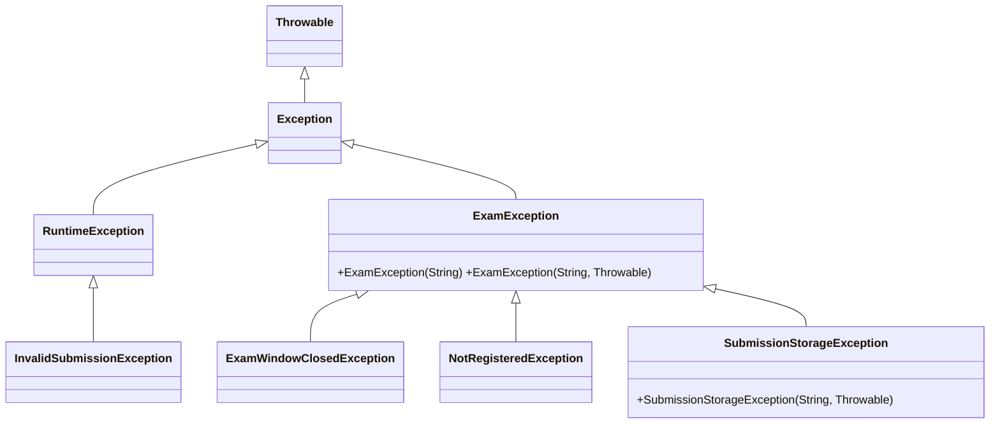

# Q2 – User-Defined Exceptions and Propagation in an Online Examination Portal (K4 – Analyse)

## Shared work – design

| Exception | Extends | Checked? | Thrown by | Reason |
|---|---|---|---|---|
| `ExamException` | `Exception` | checked | (root) | every portal business failure is expected and must be handled |
| `ExamWindowClosedException` | `ExamException` | checked | Service | recoverable: tell the student the window is closed |
| `NotRegisteredException` | `ExamException` | checked | Service | recoverable: tell the student to register |
| `SubmissionStorageException` | `ExamException` | checked | Storage | recoverable: ask the student to retry / use a smaller file; **wraps** the `IOException` as its cause |
| `InvalidSubmissionException` | `RuntimeException` | **unchecked** | Service | blank/null file name = programming/argument error; the student cannot "recover", so callers are not forced to catch |

`throws` is declared on `SubmissionService.submit` and `Storage.save`; `throw` is used in each layer; chaining is done in `Storage.save` with `new SubmissionStorageException("Could not store …", e)`.

## Student A – Hierarchy and propagation design

### Class diagram



### Why checked / unchecked
* The three `ExamException` subclasses describe *normal operating conditions* (late, unregistered, disk full). The caller can and must decide what to do → **checked**: the compiler guarantees nobody forgets.
* `InvalidSubmissionException` is a *bug in the caller's data*. Forcing every layer to declare it would add noise with no recovery → **unchecked**.

### Propagation path of the storage exception (`PropagationDemo` output)

```
Storage.lowLevelWrite()  throws IOException("Disk quota exceeded: 800 KB > 500 KB")
   ▼  caught in Storage.save()  → wrapped as SubmissionStorageException (cause = IOException)
Storage.save()           throws SubmissionStorageException
   ▼  declared in throws, not caught
SubmissionService.submit()  (line 16)
   ▼  declared in throws, not caught
ExamController.submit()  ← FINAL HANDLER: catch (SubmissionStorageException)
```
`getStackTrace()` printed: `Storage.save() line 9 → SubmissionService.submit() line 16 → PropagationDemo.main() line 4`; root cause `java.io.IOException - Disk quota exceeded: 800 KB > 500 KB`.

### Where it is finally handled and what the student sees
In `ExamController.submit` (the outermost layer). The student sees:
`SORRY: your file was not saved (Could not store big.pdf). Please try a smaller file.` – no technical detail such as "disk quota", paths or class names.

## Student B – Failure scenarios and chaining evidence

### Test table (`PortalDemo`)

| Scenario | Input | Exception | Message shown |
|---|---|---|---|
| S1 valid | S1, CSA09, 120 KB, 10:00 | none | `SUCCESS: ans.pdf submitted` |
| S2 window closed | hour 13 | `ExamWindowClosedException` | `REJECTED: Exam window closed at 12:00` |
| S3 not registered | student S9 | `NotRegisteredException` | `REJECTED: S9 is not registered for CSA09` |
| S4 file too large | 800 KB | `SubmissionStorageException` (cause `IOException`) | `SORRY: your file was not saved (Could not store big.pdf)…` |
| S5 blank name | `" "` | `InvalidSubmissionException` (unchecked) | `BAD REQUEST: file name is blank` |

### Chaining with `getCause()` and the full chained stack trace (`ChainDemo`)

```
getMessage()       : Could not store big.pdf
getCause()         : java.io.IOException: Disk quota exceeded: 800 KB > 500 KB
SubmissionStorageException: Could not store big.pdf
	at ChainDemo.layerSave(ChainDemo.java:7)
	at ChainDemo.layerService(ChainDemo.java:11)
	at ChainDemo.main(ChainDemo.java:14)
Caused by: java.io.IOException: Disk quota exceeded: 800 KB > 500 KB
	at ChainDemo.layerSave(ChainDemo.java:5)
	... 2 more
```
`Caused by:` shows the original exception **and the line where the failure started** (line 5), while the outer trace shows where the wrapper was created (line 7).

### What is lost without the cause

```
getCause()         : null
SubmissionStorageException: Could not store big.pdf
	at ChainDemo.layerSave(ChainDemo.java:8) ...
```
Lost: the original exception **type** (`IOException`), its **message** (quota 800 > 500 KB) and the **origin line**. An engineer reading the log would only see "Could not store big.pdf" and not know *why*.

## Complete the Code – `StorageDemo` (TODO 1)

```java
throw new SubmissionStorageException("Could not store " + fileName, e);
```
Output (matches expected):
```
Saved answer01.pdf
Error: Could not store answer02.pdf
Cause: Disk quota exceeded
```
**If the IOException were not passed to the constructor** (`extras/NoCauseDemo`): `getCause()` returns `null`, so `e.getCause().getMessage()` throws **`NullPointerException`** and the "Cause:" line is never printed (our demo catches it and prints `Cause line -> NullPointerException (getCause() is null)`). Even worse, the diagnostic information is gone.

## Joint conclusion – why `SubmissionStorageException` and not a raw `IOException`?
A raw `IOException` leaks an implementation detail of the storage layer (files, disks) to the user interface, which then has to know about disks. If the storage were changed to a database or cloud bucket, the UI code would have to change too. A meaningful domain exception keeps the layers independent ("a submission could not be stored"), lets the controller give a friendly message, and – because it is chained – the original `IOException` remains available to the logs.

## Alternative concept – make the exceptions unchecked

* **Signatures:** remove `throws ExamException` from `Storage.save`, `SubmissionService.submit`; `Storage.save` still catches `IOException` (that is a JDK checked exception) and wraps it, but the declaration `throws SubmissionStorageException` is no longer needed.
* **Calling code:** `ExamController` is no longer *forced* to catch; it still can, but a forgotten catch compiles and the exception would escape to the top, killing the request thread. Less boilerplate, less safety.
* **Time/space of capturing a stack trace** (`ExceptionCost`, 50,000 exceptions, depth = stack depth):

| depth | kind | ns / exception | bytes / exception |
|---|---|---|---|
| 5 | single | 2,025 | 1,160 |
| 5 | chained (outer+inner) | 2,348 | 1,888 |
| 5 | **no stack trace** (`writableStackTrace=false`) | 168 | 56 |
| 50 | single | 7,982 | 4,360 |
| 50 | chained | 7,409 | 5,776 |
| 50 | no stack trace | 37 | 56 |
| 500 | single | 63,195 | 39,192 |
| 500 | chained | 73,068 | 50,240 |
| 500 | no stack trace | 337 | 56 |

* **Complexity:** capturing the stack trace is `fillInStackTrace()` = **O(d)** time and **O(d)** space (d = call depth) – checked or unchecked makes **no difference**; the cost is the same. Chaining adds a second exception object, so memory ≈ **sum of the traces of every exception in the chain** (≈ +60 % at depth 5 in our measurement, +28 % at depth 500 where the inner exception was created at the same depth), and the chain keeps the inner object (and its trace) alive as long as the outer one is referenced.
