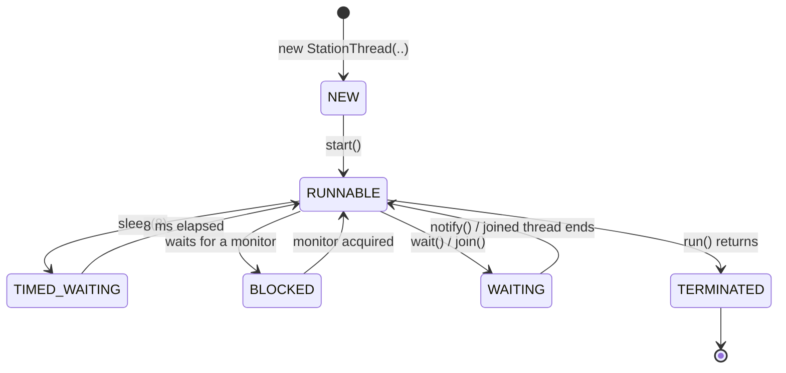

# Q4 – Thread Creation and the Thread Life Cycle (K4 – Analyse)

Four scanner stations process batches of scripts (25, 30, 35, 40). Each "scan" of 5 scripts costs `sleep(8)`.
Programs: `StationThread` (extends `Thread`), `StationTask` (implements `Runnable`), `CreationDemo`, `RunVsStart`, `LifeCycle`, `OrderExperiment`, `DaemonDemo`, `PoolDemo`.

## Shared work – both styles with start(), sleep(), join(), isAlive()
`CreationDemo` output (abridged):
```
alive after 20 ms : true true true true        <- isAlive(): still scanning
Station-2 finished, scanned 30                 <- order differs from start order
Station-1 finished, scanned 25
...
alive after join  : false false false false
TOTAL scanned (extends Thread) = 130
TOTAL scanned (Runnable)       = 130   (printed only after every join() returned)
```
130 = 25 + 30 + 35 + 40 in both styles.

## Student A – Thread design

### Extending `Thread` vs implementing `Runnable`

| | `extends Thread` | `implements Runnable` |
|---|---|---|
| What it models | the task **is** a thread | the task is *separate* from the thread that runs it |
| Inheritance | uses up the single superclass slot | class may still extend another class |
| Reuse | one object = one thread; `start()` once only | same task can be run by many threads, executors, pools |
| Lambdas / `Executor` | not usable with a pool directly | `Runnable`/`Callable` is what executors accept |
| Prefer when | you need to customise thread behaviour itself (rare) | **almost always** – separation of work and mechanism |

### Thread life-cycle state diagram – states each station passes through


**Each station passes through:** NEW → RUNNABLE → (TIMED_WAITING ↔ RUNNABLE, repeated once per 5 scripts) → TERMINATED. `main` itself is in WAITING/TIMED_WAITING while in `join()`. `LifeCycle` printed every state:
```
sleeper after new      : NEW
sleeper after start    : RUNNABLE
sleeper inside sleep() : TIMED_WAITING
sleeper after finish   : TERMINATED
blocked, lock held     : BLOCKED
waiter inside wait()   : WAITING
```

### `run()` vs `start()` – evidence (`RunVsStart`)
```
main thread is: main  (id 1)
t1.run():
   body executes in thread: main  (id 1)        <- plain method call on the main thread
   t1 state after run(): NEW                    <- no thread was ever started
t2.start():
   body executes in thread: worker-B  (id 14)   <- JVM created a new thread
   t2 state after join(): TERMINATED
t2.start() again -> java.lang.IllegalThreadStateException
```
`run()` is just the method body; only `start()` asks the JVM to create a native thread, which then calls `run()`. Calling `run()` therefore executes sequentially in the caller – no concurrency.

### How `join()` ensures the total is printed last
`t.join()` makes the calling thread (main) wait until `t` is TERMINATED. `main` calls `join()` on all four stations *before* it adds up `scanned`, so the sum is computed only after every `run()` has finished (and, by the Java memory model, `join()` also makes the stations' writes to `scanned` visible to main). Without `join()` main would print a partial total (the first alive-check showed all stations still working after 20 ms).

## Student B – Behavioural experiments (`OrderExperiment`, 12 runs each, identical workloads on purpose)

### Equal priorities – finishing order
| Run | Order | Run | Order | Run | Order |
|---|---|---|---|---|---|
| 1 | S1 S3 S4 S2 | 5 | S4 S1 S3 S2 | 9 | S1 S2 S4 S3 |
| 2 | S2 S3 S1 S4 | 6 | S2 S4 S3 S1 | 10 | S2 S3 S1 S4 |
| 3 | S4 S1 S2 S3 | 7 | S1 S2 S4 S3 | 11 | S1 S3 S4 S2 |
| 4 | S2 S3 S1 S4 | 8 | S4 S2 S1 S3 | 12 | S2 S1 S4 S3 |

**8 distinct orders in 12 runs**; first finisher: S2 ×5, S1 ×4, S4 ×3 (S3 never first in this sample).

### Priorities (S1 = MIN 1, S4 = MAX 10, others 5)
11 distinct orders in 12 runs; first finisher: S4 ×5, S1 ×3, S2 ×3, S3 ×1. S1 (the lowest priority) still finished first 3 times and S4 (highest) first only 5 of 12, so **priority did not produce a reliable order**. On Linux HotSpot, Java priorities are only a hint and are by default mapped to the same OS priority; the scheduler time-slices the runnable threads however it likes.

### Daemon thread (`DaemonDemo`)
```
mode=USER: main() ends at 205 ms
  Station-4 finished its batch after 1505 ms       <- JVM stayed alive for the user thread
mode=DAEMON: main() ends at 207 ms                 <- JVM exited at once; Station-4's output never appears
```
The JVM exits when the last **non-daemon** thread ends; daemon threads are killed abruptly (no `finally`, no output). A daemon station would lose its scan results if `main` ends first.

### Explanation using the scheduler
The OS/JVM scheduler decides which RUNNABLE thread gets the CPU and for how long; wake-ups after `sleep(8)` depend on timer granularity, other load and context-switch timing, none of which the program controls. Equal work therefore finishes in an order that varies run to run.

## Joint conclusion – why different orders, and why a correct program must not depend on them
Thread scheduling is non-deterministic: the same code can interleave differently each run (we saw 8 and 11 different orders in 12 runs). A program whose correctness depends on one order will work in testing and fail in production. Correct programs establish order explicitly: `join()`, locks, `Future.get()`, latches.

## Alternative concept – `ExecutorService` with a fixed thread pool (`PoolDemo`)
```java
ExecutorService ex = Executors.newFixedThreadPool(p);
for (batch : batches) futures.add(ex.submit(task));   // tasks queue up; p threads reuse themselves
for (Future f : futures) f.get();                     // replaces join()
ex.shutdown();
```
n = 400 scripts → 40 batches of 10, 20 ms each:

| approach | measured time | expected | threads created |
|---|---|---|---|
| a `Thread` per batch | 26 ms | 20 ms (all concurrent) | 40 |
| FixedThreadPool(1) | 817 ms | 800 ms | 1 |
| FixedThreadPool(2) | 406 ms | 400 ms | 2 |
| FixedThreadPool(4) | 204 ms | 200 ms | 4 |
| FixedThreadPool(8) | 102 ms | 100 ms | 8 |

* **Time:** a pool with p threads needs ⌈batches / p⌉ rounds → **T ≈ (n/b)/p × t_batch = O(n/p)**; measured values match the formula within ~2 %. Thread-per-batch finishes in one round only because the work is *sleep*; for CPU-bound work it is limited by the number of cores and pays thread-creation cost per task.
* **Memory:** each platform thread reserves a stack (default 1 MB on 64-bit Linux; virtual, committed on use). Thread-per-batch: 40 threads ≈ 40 MB reserved; pool of 4 ≈ 4 MB. Space = **O(#threads) × stack**: O(n/b) for thread-per-task, **O(p)** for the pool, plus O(n/b) small queued task objects.
* The pool also reuses threads (no create/destroy per task), gives `Future` results and exception capture, and gives a single shutdown point.
