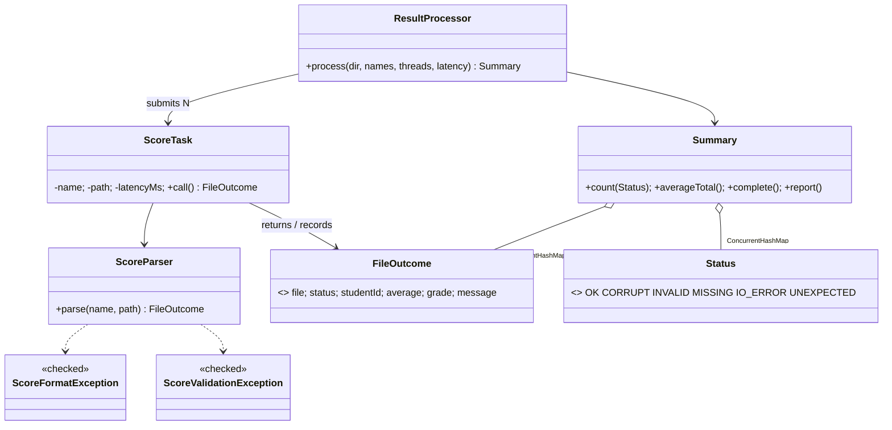

# Q7 – Design a Concurrent, Fault-Tolerant Processor from First Principles (K5 – Evaluate)

Requirement: process 10,000 score files; each is read, validated and turned into a result; some are corrupt or missing; finish quickly; one bad file must not stop the run; a summary of successes and failures must be produced.

Source: `src/` – `ResultProcessor` (executor + futures), `ScoreTask` (Callable), `ScoreParser`, `FileOutcome`, `Status`, `Summary`, exceptions, `GenData` (data + fault injection), `SmallCheck` (hand-checked), `Verify`, `Benchmark`, `Alternatives`.
Data: `GenData` writes 10,000 files into `data/` (not committed) with deterministic faults and an independent `expected_counts.txt`. File format: `studentId,m1,m2,m3,m4,m5` (marks 0–100); result = average and grade.

---
## Stage 1 – Interpret the problem (Joint, 2 marks)

### Tasks that can run in parallel / shared data
| Item | Parallel? | Why |
|---|---|---|
| read + parse + validate + compute for one file | **yes** – each file is independent | no data flows between files |
| writing the result into the shared result set | needs coordination | many workers write at the same time |
| incrementing the per-status counters | needs coordination | many workers increment the same counters |
| building the final summary | **after** all files are done | needs all results |
| manifest (list of file names) | read-only | no sharing problem |

**Shared mutable data:** the results map and the counters. Nothing else is shared (each task works on its own `Path`, local variables and an immutable `FileOutcome`).

### Failures and their handling
| Failure | Detected as | Handling | Status |
|---|---|---|---|
| file listed but missing | `NoSuchFileException` | record, continue | MISSING |
| path is not a readable file (directory, permission) | other `IOException` | record, continue | IO_ERROR |
| empty file / wrong number of fields / non-numeric mark | `ScoreFormatException` (checked) | record, continue | CORRUPT |
| mark outside 0..100 | `ScoreValidationException` (checked) | record, continue | INVALID |
| a *bug* in processing one file (any `RuntimeException`) | escapes `call()` → `ExecutionException` from `Future.get()` | record, continue | UNEXPECTED |
| collector interrupted | `InterruptedException` | restore interrupt flag, stop collecting; summary flagged incomplete | UNEXPECTED |
| pool not terminating | `awaitTermination` time-out | `shutdownNow()` | – |

### Requirements as measurable statements
* **R1** Exactly one outcome per submitted file: `results.size() == 10,000` and the sum of status counts `== 10,000`.
* **R2** A bad file never aborts the run: all injected faults are reported and the remaining files still processed (count of non-OK outcomes = injected faults).
* **R3** The summary matches independently generated expectations exactly (counts per status and the sum of averages).
* **R4** Speed: with 1 ms storage latency per file, 8 threads finish 10,000 files in ≤ 2 s (1 thread needs ≥ 10 s).
* **R5** No leaked threads: the pool is terminated before `process()` returns.

---
## Stage 2 – Design (Student A, 3 marks)

### Class diagram


### Pseudocode
```
process(dir, names, p):
    results ← new ConcurrentHashMap<name, FileOutcome>
    counts  ← new ConcurrentHashMap<Status, LongAdder>
    pool    ← newFixedThreadPool(p)
    try
        futures ← [ pool.submit(ScoreTask(n)) for n in names ]
        for each future f (with its file name n):
            try   f.get()
            catch ExecutionException:  record(UNEXPECTED, cause)      # bug in ONE task
            catch InterruptedException: record(UNEXPECTED); restore flag; break
    finally
        pool.shutdown(); awaitTermination(1 min) else shutdownNow()
    return Summary(results, counts)

ScoreTask.call():
    sleep(latency)                       # (simulated slow storage)
    try    outcome ← parse(file)         # OK
    catch NoSuchFile → MISSING;  IOException → IO_ERROR
          ScoreFormat → CORRUPT; ScoreValidation → INVALID
    record(outcome)      # results.putIfAbsent(file, outcome) then counts[status].increment()
    return outcome       # RuntimeException is NOT caught here → captured by the Future
```

### Choice of concurrent collection – `ConcurrentHashMap<String, FileOutcome>` (+ `LongAdder` per status), and why
* many workers write at the same time to **different keys** (file names) – `ConcurrentHashMap` uses CAS and per-bin locking, so writers rarely block each other;
* `putIfAbsent` makes recording **idempotent / exactly-once**: a file can never be counted twice, which supports R1;
* lookup by file name is O(1) (needed for the summary and tests);
* `LongAdder` spreads increments over cells, so the per-status counters do not become a contention hot-spot (better than a single `AtomicLong`);
* rejected alternatives: `Collections.synchronizedMap` (one global lock for every put), `ConcurrentLinkedQueue` (no lookup and no duplicate detection), `CopyOnWriteArrayList` (copies the array on every write: O(n) per add ⇒ O(n²) total for 10,000 files), `Vector`/`synchronized` list (single lock).
* The map is read only after all futures completed, so its weakly-consistent iteration is not a problem.

### Exception handling – one failure must not stop the run
Two layers: (1) **expected** failures are caught *inside* the task and converted into a `FileOutcome` – the task returns normally; (2) **unexpected** failures escape `call()`, are stored by the `Future`, and are caught in the collection loop as `ExecutionException` – the loop continues with the next future. The pool is shut down in `finally`.

---
## Stage 3 – Implement and measure (Student B, 3 marks)

### Fault injection (10,000 generated files)
| Injected fault | Rule | Count |
|---|---|---|
| non-numeric mark (`x40`) | index % 50 == 7 | 200 |
| missing file (listed, not written) | index % 100 == 13 | 100 |
| mark 140 (out of range) | index % 200 == 21 | 50 |
| empty file | index % 500 == 33 | 20 |
| a *directory* instead of a file | index % 1000 == 999 | 10 |
| "poison" file → simulated bug (`IllegalStateException`) | index % 2500 == 5 | 4 |
| **total faults** | | **384** (valid files: 9,616) |

### Verification on a small hand-checked set (`SmallCheck`, 10 files, expected values worked out by hand first) – all pass
```
PASS OK count 5   PASS CORRUPT 2 (letters + empty)   PASS INVALID 1   PASS MISSING 1   PASS UNEXPECTED 1 (poison)
PASS total accounted 10   PASS sum of averages (80+50+100+0+75) = 305.00   PASS grade ok1=A, ok4=F   PASS summary complete
10 passed, 0 failed
```

### Verification on the full set (`Verify`, 4 threads) – independent expectations from `GenData`
```
PASS OK 9616   PASS CORRUPT 220 (200 + 20 empty)   PASS INVALID 50   PASS MISSING 100   PASS IO_ERROR 10   PASS UNEXPECTED 4
PASS sumOfAverages 480842.60        ALL CHECKS PASSED
```

### Total time with 1, 2, 4, 8 (and 32) threads (`Benchmark`; sandbox reports 1 CPU core)

| Threads | Time, no latency (ms) | speed-up | Time, 1 ms simulated storage latency (ms) | speed-up |
|---|---|---|---|---|
| 1 | 182 | 1.00× | 11,470 | 1.00× |
| 2 | 98 | 1.86× | 5,755 | 1.99× |
| 4 | 92 | 1.98× | 2,858 | 4.01× |
| 8 | 82 | 2.22× | 1,441 | 7.96× |
| 32 | 85 | 2.14× | 381 | 30.10× |

(best of 5 runs for no latency, best of 2 for 1 ms latency; one warm-up run each.)
Graph of speed-up (latency case): 1→1.0, 2→2.0, 4→4.0, 8→8.0, 32→30.1 (almost linear); no-latency case: 1→1.0, 2→1.9, 4→2.0, 8→2.2, 32→2.1 (flat after 2).

### Failures not handled correctly / limitations found while testing
* In the final run **no injected fault was mis-handled** (all 384 were classified as expected, 0 lost, 0 duplicated).
* My first version of the parallel-stream experiment *appeared* to succeed with a poison file because `Stream.count()` skips the `map` step on a sized stream – a **test bug**, found and fixed (`collect` instead of `count`), and recorded here because the result looked wrong before I understood it.
* **Not handled:** a task that *hangs* (a stuck read) – `Future.get()` has no time-out, so the whole run would hang; `OutOfMemoryError` inside a task; and if the collector thread is interrupted, remaining files are not recorded (the summary reports `complete: false` instead of silently looking complete).

---
## Stage 4 – Defend the design (Joint, 2 marks)

### Recommended pool size, and why more threads did not always help
* **Work with waiting (storage latency 1 ms):** speed-up is almost linear – 8 threads = 7.96×, 32 threads = 30×. While one thread waits for storage the others run, so threads ≈ cores × (1 + wait/compute) is the useful size, and for slow/network storage it is large.
* **Work without waiting (latency 0, pure parse):** 2 threads give 1.86× (overlap of file-system calls with parsing and with the main thread submitting tasks), but 4, 8 and 32 threads give only 1.98×, 2.22×, 2.14×: there is no idle time left to fill (the machine has 1 core), so extra threads add context switches, queue contention and stack memory without more throughput.
* **Recommendation:** a fixed pool of **8 threads** (here). It captures the whole gain of the no-latency case (82 ms vs 85 ms for 32), gives ~8× on slow storage, and needs only ~8 MB of thread stacks. On the real server: start with `cores × 2` for local disks and raise it only while measurements still improve, because the best size depends on the storage latency, which must be measured.

### How the design guarantees a complete and correct summary
1. Every file gets a task, and every task ends in exactly one of: *recorded outcome* (expected failures caught inside), or *exception captured by its `Future`* and recorded in the loop.
2. `putIfAbsent` makes recording exactly-once, so no file is lost or counted twice; the counters are incremented only when the put succeeds.
3. The collector waits for **every** future before the summary is built, then `Summary.complete()` checks `results.size() == submitted` and the sum of counters `== submitted`; if not, the summary says so.
4. The pool is always shut down in `finally`.
5. Correctness is evidenced against independently generated expectations: hand-checked 10 files and generated 10,000 files (counts and sum of averages match exactly).

### One remaining limitation
No per-file **time-out** (and no retry for transient `IO_ERROR`s): one hung read would block `Future.get()` and the whole run. Fix: `future.get(timeout)` with `cancel(true)`, or time-limited reads.

---
## Alternative Concept and Complexity Analysis (`Alternatives`, 10,000 files)

### What the solution would be
```java
// parallel streams
Map<Status, Long> m = names.parallelStream()
        .map(n -> { try { return handle(n).status(); } catch (Exception e) { return Status.UNEXPECTED; } })
        .collect(groupingBy(s -> s, counting()));

// one thread per file
for (String n : names) { Thread t = new Thread(() -> handle(n)); t.start(); threads.add(t); }
for (Thread t : threads) t.join();
```

### Measurements
| Approach | Result observed |
|---|---|
| parallel stream, **no** per-element try/catch | **the whole stream fails** on the first poison file (`IllegalStateException … score_poison_02505.txt`) – **no summary at all** |
| parallel stream with per-element try/catch | same counts as the executor design (OK=9616, CORRUPT=220, INVALID=50, MISSING=100, IO_ERROR=10, UNEXPECTED=4); 347 ms (cold run, no warm-up – not directly comparable with the warmed-up benchmark) |
| parallel stream, 1 ms latency per file | **5,630 ms** – the common pool had parallelism 1 (+ the caller thread), i.e. ≈ N/2 × 1 ms; the pool size is set by the CPU count, not by the I/O delay; 8-thread executor: 1,441 ms |
| one thread per file | 10,000 threads started, all 10,000 outcomes processed, 4 unexpected failures caught per thread; 1,600 ms (≈ 160 µs per thread creation); peak simultaneously live task threads: 19–45 in the runs |

### Analysis
| | ExecutorService (p threads) | `parallelStream()` | one thread per file |
|---|---|---|---|
| **Total time** | O(N/p · (c + w)) – p chosen by us, can exceed the core count for I/O | O(N/(cores) · (c + w)) – parallelism fixed by the common pool unless a custom pool is used; blocking I/O wastes workers | O(N · t_create + (c + w)) if all run at once: ≈ 160 µs creation each = ≈ 1.6 s of pure overhead for N = 10,000 |
| **Memory** (threads × stack ≈ 1 MB) | **p** × 1 MB (8 MB) + N small outcome objects | (cores − 1 + caller) × 1 MB, tiny | up to **N × 1 MB = 10 GB reserved** if all alive together (actual peak here: 19–45 live because tasks finish quickly); risk of `OutOfMemoryError: unable to create native thread` |
| **Failure in one file** | caught per task, `Future` isolates it; run continues; full control | an exception from any element **aborts the whole terminal operation** unless every lambda catches; no per-element Future | kills only that thread; needs `UncaughtExceptionHandler` or try/catch to count it; nothing collects results automatically |
| Control (pool size, shutdown, timeouts) | full | little | none (manual) |

Verdict: for 10,000 files with failures that must be tolerated, the **executor + Callable + Future** design is the best: bounded memory, tunable parallelism, and per-task failure isolation with a guaranteed summary. Parallel streams are concise for pure CPU work but are risky when a single exception can discard the summary and when tasks block on I/O; one thread per file does not scale in memory and creation cost.
